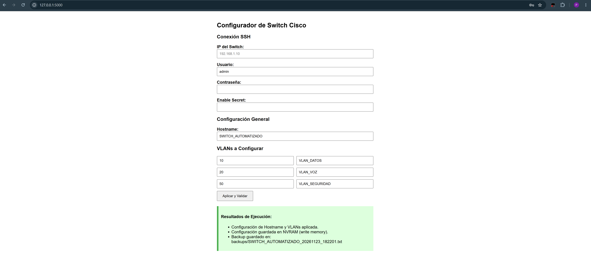
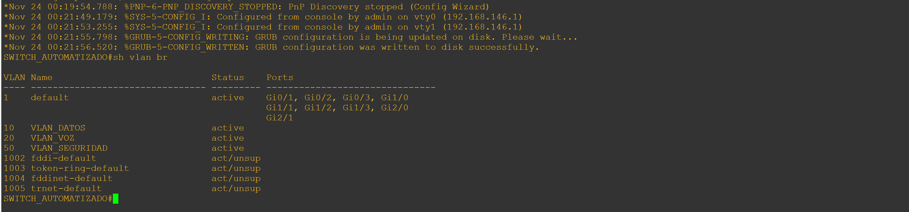
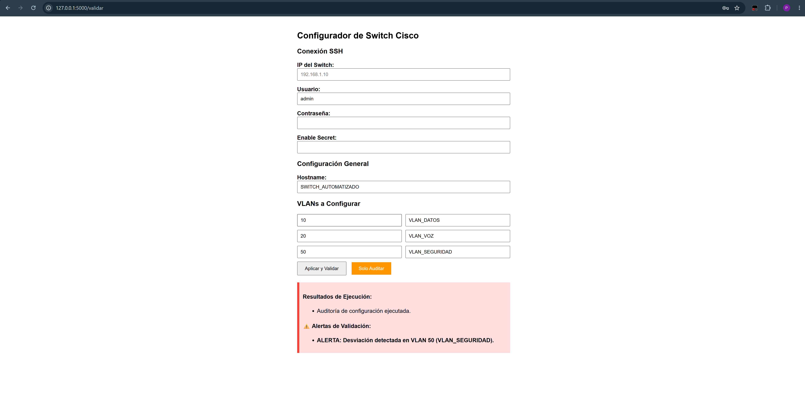

# Automatización de Switch Cisco con Python, Flask y Netmiko

Aplicación web desarrollada en Python utilizando **Flask** (frontend) y **Netmiko** (automatización SSH) para configurar VLANs, modificar el hostname, guardar la configuración en NVRAM, generar respaldos locales y validar desviaciones de configuración en switches Cisco IOS.

## Funcionalidades Principales
1. **Interfaz Web (Flask):** Permite ingresar credenciales SSH, IP del dispositivo, hostname destino e IDs/nombres de VLANs (`10: VLAN_DATOS`, `20: VLAN_VOZ`, `50: VLAN_SEGURIDAD`).
2. **Aprovisionamiento Automatizado (Netmiko):** Envía los comandos de configuración en bloque y ejecuta `write memory` para persistencia en NVRAM.
3. **Backup Automático:** Exporta el `running-config` completo a un archivo local dentro de `/backups` con el formato `<HOSTNAME>_<AAAAMMDD_HHMMSS>.txt`.
4. **Validación y Detección de Desviaciones:** Verifica el estado real del dispositivo (`show running-config` y `show vlan brief`) frente al estado deseado, desplegando alertas visuales ante cualquier discrepancia.

## Requisitos Previos
- Python 3.10 o superior
- Switch Cisco IOS (físico o virtualizado en GNS3/CML) con SSHv2 habilitado y conectividad IP hacia el host.

## Instalación y Ejecución
1. Clonar el repositorio:
   ```bash
   git clone https://github.com
   cd cisco-vlan-automation
   ```
2. Crear y activar el entorno virtual:
   ```powershell
   python -m venv venv
   .\venv\Scripts\activate
   ```
3. Instalar las dependencias del proyecto:
   ```powershell
   pip install -r requirements.txt
   ```
4. Iniciar el servidor web:
   ```powershell
   python app.py
   ```
5. Abrir el navegador en `http://127.0.0.1:5000`.

## Uso del Frontend
1. Completar los datos de **Conexión SSH** (IP del switch, usuario, contraseña y *enable secret*).
2. Confirmar o personalizar el **Hostname** (`SWITCH_AUTOMATIZADO`) y las **VLANs** requeridas.
3. Presionar **Aplicar y Validar** para ejecutar los cambios, generar el backup y verificar cumplimiento, o **Solo Auditar** para validar desviaciones sin modificar el equipo.

## Notas de Implementación
- Para compatibilidad con imágenes virtualizadas Cisco IOSvL2 que negocian llaves `ssh-rsa` e intercambio `diffie-hellman-group14-sha1`, se fijó `paramiko==3.5.0` en `requirements.txt` y se configuró `disabled_algorithms` en la sesión de Netmiko.
- Los archivos de respaldo se almacenan automáticamente en la carpeta [`backups/`](backups/).

## Evidencias de Ejecución

### 1. Configuración Exitosa desde el Frontend


### 2. Verificación en la CLI del Switch (`show vlan brief` y Hostname)


### 3. Validación Post-Configuración y Alerta por Desviación

